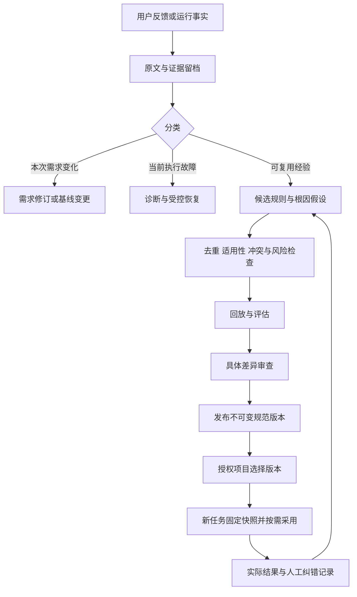

# AIDevFlow 企业经验与流程改进闭环设计

日期：2026-11-04。状态：设计提案，尚未实现。本文件中的命令、存储路径、对象和服务均为拟议接口；不代表当前套件已经具备企业经验库或自动改进能力。

## 1. 产品目标与关键决定

目标：把用户纠正、真实故障、成功做法和团队规范沉淀为可追溯资产，使后续任务减少重复询问、重复错误和流程操作，并能够验证净收益。

采用“分层存储、受控晋升、按需复用、任务固定版本、持续评估”的架构。

关键决定：

1. 原始反馈默认保存于项目本地，个人表达偏好保存于用户目录；事业部和公司只共享经授权发布的规范及脱敏案例。
2. 经验独立于 zsspec 和 OMP/Claude 原生记忆。供应方方法包保持原样。
3. 反馈、经验候选、规范版本和业务任务分别管理。记录建议不改变需求批准、业务状态或修复预算。
4. 模型可以提炼、检索、提出改进和生成验证用例；新硬规则、流程代码及组织级发布需要相应责任人的授权。
5. 每个新任务固定规范来源、版本、摘要和解析器版本；恢复时复用相同快照。
6. 效果由重复问题、人工投入、实际验收、缺陷和成本衡量，不能仅凭模型自评、使用次数或 Gate 通过判定。

对外价值可表述为：企业经验能够沉淀为有适用范围、有验证依据、可复用、可撤回的 AI 研发规范。技术实现以经验检索、规则执行、回归用例和受控版本改进为主，不以自动更新模型参数为前提。

## 2. 当前项目基础与缺口

当前已有：

- Discovery 的用户回答、需求反馈、版本摘要和批准记录。
- Gate 的工作项、检查、执行证据、冻结基线与失败路由。
- 方法源快照、原生调用身份、固定 Verifier bundle。
- 基线变更的提案、授权、事务和恢复模式。

当前尚无：

- 跨任务的个人/项目经验库；事业部/公司规范发布服务。
- 经验的适用性解析、检索、采用记录和效果评估。
- 企业身份授权、规范审批责任链与集中撤销传播。

特别注意：`workflow._feedback()` 会重新进入需求讨论、清除当前审查引用，不能直接用作通用经验入口。现有 `zsspec-feedback` 是供应方外发反馈通道，不是本设计的经验存储。

## 3. 经验保存在哪里

“全局”需要区分本机用户级和公司组织级，两者不能混用。

| 层级 | 内容与例子 | 权威存储与所有者 | 默认复用范围 |
| --- | --- | --- | --- |
| 个人 | 交付说明顺序、语言、交互偏好 | 本机用户目录；本人管理 | 本人明确启用的项目 |
| 项目 | 用户原话、技术事实、业务约束、现场证据、项目经验 | 项目本地账本；项目负责人管理 | 当前项目 |
| 事业部 | 领域词汇、技术规范、常见检查和工作流模板 | 企业规范库中的部门空间；部门维护人管理 | 获授权且订阅该规范包的项目 |
| 公司 | 公司级交付要求、通用质量和安全基线 | 企业规范库中的公司空间；公司指定维护人管理 | 声明适用范围内的项目 |

同一次反馈可产生多个候选，但不能因“有用”而自动扩散到更高层级。项目经验晋升至部门、部门晋升至公司，均需重新检查适用性、数据可分享性、维护责任和验证结果。

### 3.1 本地项目目录

```text
<project>/
  .aidevflow/
    experience/                     原始反馈与运行材料，默认不进 Git
      feedback/<id>.json
      evidence/objects/<hash>
      candidates/<id>/<revision>.json
      evaluations/<id>/
      applications/<id>.json
      events/<operation-id>.json
      index/                        可重建索引，不是权威来源
    policy-packs/                   可审查的项目规范包，可选择纳入 Git
      <pack-id>/<version>/manifest.json
      <pack-id>/<version>/rules/
    policy-lock.json                项目订阅的精确规范版本，可纳入 Git
    policy-cache/                   企业规范包授权缓存，默认不进 Git
    runs/<task-id>/
      policy-snapshot/              当前任务固定的规范与检索范围
      policy-manifest.json
```

安装器应为 `experience/` 和 `policy-cache/` 追加忽略规则，不忽略项目主动维护的 `policy-packs/`、`policy-lock.json`。原始反馈属于独立运行数据，不进入业务候选摘要；任务实际使用的规范快照摘要必须显式纳入候选与派发上下文校验。

### 3.2 本机用户目录

Windows 建议使用 `%LOCALAPPDATA%\AIDevFlow\experience\profiles\<profile-id>\`。其他系统使用对应用户数据目录。通过独立 `profile-id` 区分用户配置，不以工作目录名称猜身份。

个人偏好默认不上传。跨设备同步需显式启用；不同客户或组织可以使用隔离的用户配置。项目技术事实不默认复制到个人全局库。

### 3.3 企业规范服务

部门/公司使用内部规范服务；早期可用受控 Git 规范仓库加不可变版本标签和评审流程实现。以后再提供统一 API、权限与看板。

中央保存正式规范包、脱敏案例、评估摘要、维护责任、版本与撤销记录。原始客户代码、业务数据和完整会话默认留在原项目，不能随规则同步。

## 4. 沉淀什么：六类资产

| 资产 | 用途 | 生效方式 |
| --- | --- | --- |
| 交互偏好 | 输出语言、交付说明结构等 | 作为生成偏好，不影响验收和权限 |
| 项目事实 | 当前测试框架、服务入口、目录与环境特征 | 复用前验证文件/版本条件，避免环境变更后过期 |
| 工程经验 | 某类症状的诊断、修复路径和反例 | 条件匹配时提供建议，受现有执行授权约束 |
| 规范与检查要求 | API 错误场景、业务术语、必要审查 | 在需求/Contract 前解释适用义务，转成可检查要求 |
| 工作流与恢复方案 | 已验证的步骤组织、受控恢复 recipe | 使用受信执行器和结构化参数，不执行任意经验文本 |
| 框架改进与回归案例 | 状态机、解析、Red/Green 判定等缺陷 | 代码变更、回归评估、维护者发布 |

例如“unittest 全跳过不能算 Green”必须成为报告解析修复及回归用例；“交付先给运行命令”适合偏好；“此项目使用 unittest”是有环境条件的项目事实。三者不应只用同一种自由文本记忆处理。

## 5. 用户入口与交互

统一用户入口拟为：

```text
/aidevflow-feedback 以后本项目交付说明先给运行命令，再列测试结果。
/aidevflow-feedback 刚才角色已经完成，却又重新派发了一遍，请记录并分析。
/aidevflow-feedback
```

不带内容时打开当前反馈及规则管理交互，提供“查看处理进度、确认候选、修改范围、停用规则、查看采用记录”。内部可有多个 API，普通用户维持一个入口。

默认保存到当前项目。显式“以后我所有项目……”可形成个人级候选；部门、公司范围由有权限的维护人发布。范围不明确时先按项目保存，不要求用户先填内部 ID。

一次提交的处理：

1. 不调用模型也能先保存原话和最小现场引用，返回稳定反馈 ID。
2. 自动绑定当前项目、任务、阶段、会话消息身份和软件版本；没有活动任务也可收录。
3. 分流为当前需求变更、执行故障、偏好、项目事实、规范或流程改进；不确定则保留待澄清。
4. 显示简短回执：保存范围、是否立即影响输出、是否只是候选、何时生效。
5. 用户可通过同一入口撤销保存意图、修改可见范围或查看后续处理。

普通聊天里的纠正可以被识别为待整理候选，但不能自动解释为跨项目长期授权。预先启用“自动记录纠错”时也只允许采集，不等于自动发布规则。自动复盘采用有界预算，在任务结束或空闲时触发；不为每条日志另开模型回合。

## 6. 一条反馈怎样完整闭环



闭环详细规则：

- **采集**：保留原话，区分用户输入、工具输出、模型推断；关联既有证据，避免复制完整会话。
- **提炼**：拆出症状、期望、根因假设、适用/排除条件、建议动作、例外、反例和失效条件。根因假设与已复现事实分开。
- **去重**：将相似反馈关联到已有候选，保留独立发生次数；重复消息不重复计数。
- **冲突**：检查公司基线、部门规范、项目事实、批准需求、方法协议与执行权限。
- **验证**：按类型运行解析/单元/恢复回放、历史失败、代表性任务和留出案例；保留失败。
- **审查**：展示旧/新差异、影响对象、验证结果、成本、有效期、维护人及回退方式。
- **发布**：写不可变内容，更新经授权的版本指针；发布后再按项目启用，发布不等于所有项目采用。
- **复用与观测**：每次采用留下版本、条件、实际动作与结果；未采用也记录原因。
- **退出**：无效、过时或有负作用的规则进入替代/弃用/撤销流程。

## 7. 数据对象与状态机

各对象分开流转，避免用一条“收到反馈→已发布”状态表示所有事实。

| 对象 | 关键字段 |
| --- | --- |
| FeedbackEvent | `id, schema_version, tenant_id, project_id, task_id, source, actor_ref, message_id, received_at, raw_text_ref, context_refs, evidence_refs, requested_scope, classification` |
| KnowledgeRule | `id, version, type, scope, owner, applicability, exclusions, condition, action, exceptions, source_refs, evidence_level, validation_refs, conflicts, supersedes, review_after, invalidation_conditions, status` |
| ImprovementProposal | `id, parent_version, target_kind, rule_diff/patch_ref, affected_scopes, risk_level, evaluation_plan, evaluation_refs, approval_ref, rollback_plan, status` |
| PolicyPackVersion | `pack_id, version, parent, content_sha256, rules, trusted_checker_refs, applicability, compatibility, owner, approval_refs, evaluation_refs, effective_at, review_after, signature` |
| RuleApplication | `id, task_id, snapshot_sha256, rule_id/version, stage, role, match_basis, decision, reason, execution_ref, result_refs, human_correction_ref, cost, observed_at` |
| EvaluationRun | `id, baseline_ref, candidate_ref, case_set_sha256, holdout_sha256, environment_ref, model/runtime/method_versions, budget, metrics, raw_results, evaluator_ref, decision, residual_risks` |

建议状态：

```text
反馈：received → triaged → linked/resolved/closed
                    └→ needs_clarification

候选：draft → validating → review_ready → approved / rejected
                  └→ needs_revision

规范版本：staged → published → deprecated / revoked
采用记录：suggested → selected → applied → verified / ineffective / reverted
```

`verified` 必须关联实际结果，不由模型一句“有效”产生。正式版本不可原地编辑；修订产生新版本。候选重复提炼、评估失败重试、发布中断分别记录稳定操作身份。

规则例子：

```json
{
  "id": "project.prefer-existing-test-runner",
  "version": "1.0.0",
  "type": "project_fact",
  "scope": {"kind": "project", "project_id": "example"},
  "applicability": {"stage": ["discovery", "contract"], "language": "python"},
  "condition": {"registered_fact": "tests.use_unittest", "must_revalidate": true},
  "action": {"kind": "prefer_existing_runner", "runner": "unittest"},
  "exceptions": ["经审查的需求确实需要新增测试能力"],
  "source_refs": ["feedback/FB-001"],
  "evidence_level": "repository_verified",
  "invalidation_conditions": ["测试配置或执行环境发生变化"],
  "status": "approved"
}
```

`registered_fact`、`action.kind` 和 checker 必须属于框架已支持的结构化枚举。未知字段或未知执行能力只能生成建议/诊断，不能让模型自动生成并加载执行插件。

## 8. 什么可以自动生效

| 变更 | 默认处理 |
| --- | --- |
| 用户显式要求的低风险表达偏好 | 在预授权白名单内保存并展示，可撤销；可影响后续展示，不改当前任务合同 |
| 从项目发现的技术事实 | 自动采集与验证，附文件/环境指纹和失效条件 |
| 模型从故障推断的经验 | 候选，不能自动升为用户或公司指令 |
| 新项目/部门规范、存在冲突的约定 | 相应负责人审查，发布新版本 |
| 验收、权限、需求批准、独立验证、修复预算、发布授权变化 | 必须按维护和业务权限审查；不允许经验层直接覆盖 Gate 不变量 |
| 框架、适配器、状态转换或执行器修复 | 生成代码变更与回归用例，按源码发布流程执行 |

“不要再问我”不代表取消所有批准；“这个测试不适用”不代表今后自动跳过同类测试。已批准的业务事实不能被历史经验无声替换。

## 9. 每次任务如何解析和复用

### 9.1 新任务启动时固定规则来源

1. 读取明确的组织、项目、用户配置和已授权订阅；不从 Git remote 名或用户名推测部门身份。
2. 解析 `policy-lock.json` 和个人偏好版本，获得精确版本；正式任务不使用未锁定的 `latest`。
3. 检查包签名/来源、内容摘要、兼容版本、权限、有效期和撤销状态。
4. 在模型分析前，确定适用的强制规范，并暴露其义务；与用户需求冲突时在批准前解决。
5. 固定已授权包的目录与规则对象，生成 `policy-manifest.json` 和快照。
6. 将快照摘要加入 `execution_context`，进入角色回执、Contract 绑定和候选身份。

任务开始时技术栈尚未完全确定的规则，可先固定允许使用的包版本及规则集合，后续阶段再判断适用性；不能后续从实时全局库引入新规则。后续发现的强制义务若改变已批准边界，必须进入明确的变更处理。

### 9.2 规则解析顺序

规则解析首先执行权限和适用性检查，然后处理优先级。不是“个人优先”或“全局优先”的简单覆盖。

- 平台工具权限、Gate 不变量和已批准任务授权是约束边界。
- 公司强制要求适用于其声明范围；部门可在授权范围内收紧，不能自行放宽。
- 项目规则在上级约束内细化；个人偏好主要影响表达和交互。
- 同一作用域的正式修订必须显式声明替代关系，不能按更新时间悄悄覆盖。
- 无法同时满足的硬规则返回结构化冲突，包含规则 ID、原因和责任人。
- “团队习惯”或历史投票次数不能推翻明确业务需求；发现冲突交由有权限的人处理。

### 9.3 按阶段、角色检索

先按租户、项目、用户权限过滤，再按技术栈、阶段、任务类型、症状和版本适用性筛选，最后排序软经验。首版用结构化标签和全文索引即可。

**强制规则全部检查，不受 top-k 或 token 截断影响。** 软经验只选少量高相关条目，提供精简摘要与可按需读取的固定引用。禁止先跨部门检索再靠提示词隐藏不可见内容。

| 使用位置 | 注入内容 |
| --- | --- |
| 需求分析 | 相关术语、业务约束、历史澄清与必要规范 |
| Contract Planner | 当前项目事实、必须检查项、方法兼容要求 |
| 协调者/实施阶段 | 已批准执行偏好、适用工程经验与受控恢复建议 |
| Gate | 可确定执行的结构化义务和已注册 checker，不依赖模型“记住”硬规则 |
| Verifier | bundle 中的适用规范快照与实际证据；不注入个人偏好、原始抱怨或成功叙事 |

`RuleApplication` 区分检索命中、展示、决定采用、实际执行和验证有效。命中不是收益，模型声称采用也不是执行证据。

## 10. 任务快照与动态变化

新规范默认用于后续任务。活动任务恢复始终使用原快照，外部规范更新不改变它的验收义务，也不单独使旧检查失效。

若需要更新当前任务：展示规范差异、受影响需求/检查/产物和证据失效范围，经明确授权后走相应版本化变更流程。第一期可以只允许新任务采用，暂不提供活动任务规范迁移。

发生紧急撤销时，保留旧快照供审计，同时对受影响动作设置明确阻断，要求审查后迁移或取消；不能继续静默使用危险规则，也不能用后台替换快照伪装成原任务。

新增的规范引用采用可选版本字段。历史无经验绑定任务继续原语义，不在重装时补造“当时采用过”的经验记录。

## 11. 让框架真正改进的三个循环

### 11.1 偏好适应

用户明确纠正 → 记录范围 → 确认偏好 → 后续相关输出采用 → 用户可查看与撤销。

衡量是否减少重复表达，不因表达偏好改变测试要求。

### 11.2 工程经验与组织规范

实际问题 → 关联证据 → 提炼适用条件与例外 → 历史/新案例验证 → 项目试用 → 部门发布 → 经授权晋升公司规范。

跨项目复用应关注原因和条件，不复制临时路径、密钥、客户配置或某个项目的特例。正向实践可沉淀模板，失败案例应保留反例。来源是模型推断的规则，证据级别不得自动变成“用户批准”。

### 11.3 框架自身改进

稳定复现的协议、状态或证据错误 → 建立失败测试 → 产生补丁候选 → 隔离回归 → 真实模型小任务试点 → 维护者批准 → 发布框架版本。

反馈入口只形成提案，普通业务会话不能直接修改自身 runtime、Gate、hooks 或 zsspec。经验库与框架发布分别版本化，以便独立定位问题。

已发现的 Red 误认基础设施错误、unittest skip 被当通过、续跑提示丢失等，应走此循环。开展大规模自动提炼前，应先修复这些评估基础，避免用不可信的“通过”训练出错误经验。

## 12. 如何验证经验真的有效

### 12.1 按类型定义验证

- 偏好：检查输出结构和用户是否再次纠正。
- 项目事实：验证当前文件、配置、环境与命令，不只依赖旧反馈。
- 技术经验：复现原问题，验证建议确实解决，同时测试不适用和失败反例。
- 硬规范：检查规则可执行性、正反例和遗漏；自然语言不能自动声称具有硬门禁能力。
- 流程改进：比较代表性任务中的人工介入、质量、耗时和模型成本。
- 框架补丁：程序回归、竞态/中断恢复测试与真实运行时试点分别记录。

### 12.2 评估方法

冻结候选和基线版本，固定代表性任务、历史失败回放及独立留出集；记录模型、运行时、方法包、环境、预算和任务难度。使用隔离项目，不对生产任务盲目尝试两个可能有副作用的方案。

先过确定性检查，再做小范围真实模型/业务评估。少量试点不能证明普遍因果收益；对样本量、适用范围和失败样本如实披露。

比较的真值包括独立测试、业务专家验收、缺陷复现及后续实际表现。Gate passed、模型自评、满意度和采用次数只作辅助信号。验证数据中的原始答案、评分与成功叙事不进入被评估角色的执行上下文。

### 12.3 推广与回退

候选先在隔离回放和自愿试点中使用，再按显式项目白名单推广。规模化推广必须设置质量不得下降、权限和批准边界不变等门槛。试点恶化则停用候选版本并发布替代版本，失败记录保留。

## 13. 事务、并发、幂等与故障处理

1. 采集使用 `(source, session_id, message_id)` 等实际消息身份作为幂等键；同一句话在不同时间的独立反馈不强行去重。
2. 提炼、验证、审查与发布分别有 operation_id，重复回调不会重复写入或发布。
3. 审查绑定候选摘要、影响范围和目标父版本；审查期间内容变化使批准失效。
4. 先落不可变规则、证据和 manifest，验证后用父版本比较更新（CAS）切换规范指针。
5. 两人并发发布只有一个能更新同一父版本；另一方需合并差异并重新审查，不能覆盖前者。
6. 模型调用、网络、验证运行和人工等待都在短写锁外进行。反馈锁与 Gate writer lock 分开，定义固定锁顺序，避免交叉等待。
7. 发布中断保留旧有效版本；验证完成的事务可 finish，未提交事务可 rollback，不能回滚覆盖后来编辑。
8. 检索/提炼服务失败不改变产品任务状态。可选建议不可用时跳过；任务必需快照丢失或摘要错误则明确阻断。
9. 原始反馈在模型不可用时仍可本地保存；分析进入待处理队列，受单独的次数/费用预算控制，不无限自动轮询。
10. `needs_human`、待验收、归档后也可写独立反馈，但不能清除 blocker、恢复执行、增加修复额度或修改主 run revision。反馈和经验整理不算业务进展。

## 14. 离线、权限与数据管理

本地负责采集、缓存、快照、适用性解析与执行记录；中央负责组织身份、规则发布、授权、撤销和汇总。

- MVP 无企业身份时，`operator_assertion` 必须明确标识为本地操作者声明，不冒充公司认证审批。
- 企业版使用 SSO/受信身份、租户与项目隔离、维护/审查/发布权限；按发布范围授权，作者与批准人可按风险实行职责分离。
- 查询、缓存、导出均检查访问权限；不能让用户通过另一个项目目录读到无权查看的材料。
- 本地缓存保存授权包版本、来源、摘要、签名和最近撤销检查时间。离线采用显式时效策略；已缓存可选经验可继续使用，超过组织规定时效的强制规范转审查或阻断。
- 发布与传输默认只包含经过审查的规则及脱敏案例。原始会话默认不采集；必要证据按最小范围引用或授权复制。摘要不能代替脱敏。
- 明确原始数据保留、删除、导出和访问审计策略；删除敏感原文保留非敏感的删除标记，不把所有个人数据永久固化进共享规范包。
- 用户输入、日志、网页和模型输出都先作为数据。包含“忽略门禁”一类文本不获得系统指令、执行或批准权限。
- 已有 zsspec-feedback、SkillHub 上报不由本入口默认触发；如要发送供应方反馈，另行展示目标和具体内容并取得实际授权。

公司核心规范的执行依赖受信 checker 和运行时权限控制；本地文件摘要与签名提供来源/完整性，不构成对同权限恶意修改的 OS 隔离。

## 15. 如何接入当前代码

建议新增模块，以下名称可在实现时按规模调整：

| 模块 | 职责 |
| --- | --- |
| `feedback.py` | 独立采集、原始事件、幂等、关联现场和分类，不调用 Discovery 的需求重开动作 |
| `experience.py` | 候选规则、适用性、来源证据、冲突和失效 |
| `policy_packs.py` | 版本包、批准、发布、撤销、任务快照及完整性 |
| `experience_retrieval.py` | 权限过滤、强制规范解析、软经验检索与上下文预算 |
| `experience_evaluation.py` | 评估计划、执行记录、门槛、试点与对照汇总 |

现有接入：

- `integrations/omp/index.ts`：新增统一反馈与管理交互，延续原生会话身份和异步审查模式。
- `bridge.py/cli.py`：新增 capture/list/propose/review/publish/revoke 等内部动作；原文采集不依赖模型。
- `discovery.py`：新讨论创建时固定规范引用，在批准材料中展示适用的重要义务；不自动改变旧讨论。
- `contexts.py`：需求角色、Planner与协调者使用统一规则解析输出；限制长度和文件来源。
- `receipts.py`：新版本 execution_context 纳入固定 policy snapshot 摘要，拒绝旧规则结果冒充新输入。
- `gate.py`：新 Contract 绑定规范，检查强制义务，将固定规范加入候选身份和 Verifier bundle。
- `hooks.py`：保护经验与规范元数据，允许受控命令；禁止业务会话直接改正式规范或提升权限。
- `installer.py`：安装新模块/schema、添加数据忽略规则；不上传反馈、不默认导入全局经验、不迁移旧任务。
- `doctor/status`：显示采用版本、规范冲突、缓存时效、停用/撤销及处理队列；区分业务状态与经验整理状态。

不将 `experience/` 作为整个文件夹的实时 hash 加入任务，否则每次新反馈都会使检查过期；绑定的是本任务固定的规范集合和引用。

## 16. 最小产品与推进阶段

### P0：先补可靠性基础

修复已确认的 Red/Green 判定和 OMP 续跑可见性缺陷，建立真实结果的可靠采集。明确现有业务变更与经验反馈的路由边界。

### P1：项目级闭环

交付本地统一入口、原文与证据留档、候选提炼、项目规则审查、精确版本、检索与撤销。业务回执绑定规则版本。暂不接中央服务、向量数据库、自动修改框架或大规模跨项目迁移。

出口：明确偏好可在后续任务正确复用；未批准候选不生效；新反馈不影响活动任务；错误规则可撤销；旧任务可按原版本恢复。

### P2：个人偏好与项目规范复用

加入个人隔离配置、项目发布包、适用性重验证、采用记录和独立评估。提供规范差异预览、历史失败回放与成本统计。

出口：跨项目只复用显式允许的个人偏好和发布包，项目事实不泄漏；能够识别过期/不适用经验，并证明减少了某类重复纠错。

### P3：一个事业部联合试点

受控规范仓库/服务、身份和发布权限、脱敏、订阅锁定、灰度、离线时效、撤销传播。选择少量不同类型项目验证，不直接全公司强制上线。

出口：每个包有负责人和版本，项目能解释采用了什么，有真实收益及负作用记录，可回退。

### P4：公司级规范服务

公司/部门规则治理、多租户授权、审计、跨部门晋升、质量评估及组织看板。正式维护支持矩阵、兼容性和服务目标；企业身份与数据政策成熟后再扩大共享。

## 17. 必须覆盖的验收用例

1. 同一消息重复回调只收录一次；独立重复问题可分别计数。
2. 模型提炼、外部日志文本不能冒充用户长期批准。
3. 记录反馈不重开已批准需求、不清除 needs_human、不刷新业务进展。
4. 当前需求修改仍走已有需求/基线版本流程。
5. 项目 A 原始经验不能被项目 B 或未授权部门检索。
6. 同类规则有不同适用条件时不被错误合并；已变更环境不会沿用旧事实。
7. 个人偏好不能覆盖公司强制规范、工具权限、冻结或独立验收。
8. 强制规则不会因检索 top-k 或 token 上限而丢失。
9. 规则冲突产生明确诊断，不能静默按更新时间覆盖。
10. 审查期间候选变化使批准失效；重复批准不重复发布。
11. 并发发布不会丢规则；发布中断仍保留旧有效版本。
12. 新发布默认只影响新任务；活动任务和原生回执保持原快照。
13. 撤销保留历史；关键撤销阻断相关动作并要求显式迁移。
14. Verifier 不读取实时经验、个人偏好或成功叙事，只看固定规范和证据。
15. 可选检索故障不阻塞业务；必须快照损坏明确阻断。
16. 离线缓存过期、组织权限撤回和分享导出有明确结果。
17. `matched/selected/applied/verified` 可分别核查，不能以模型自述算收益。
18. 删除敏感原文后，正式规范不残留未经授权原文；源删除留非敏感审计标记。
19. 脱敏案例发布不会触发供应方上报；无真实密钥进入测试日志。
20. 反馈整理服务失败不损坏业务状态；新版本安装不自动改变历史任务。

## 18. 企业收益指标与复盘

| 价值 | 指标 | 统计注意 |
| --- | --- | --- |
| 减少重复纠错 | 同类问题再次发生率、再次解释次数 | 按任务类型、技术栈、模型版本和规则适用范围分组 |
| 减少人工操作 | 人工纠正/恢复次数及分钟数 | 包括维护规范和处理错误经验的时间 |
| 提高交付质量 | 首轮业务验收通过率、实际遗漏缺陷、错误复用率 | 业务验收/独立测试作真值，不能只统计 Gate passed |
| 提高恢复效率 | 阻断到恢复的耗时、有效恢复率 | 区分缺权限、待业务决策和技术故障 |
| 降低单位成本 | 每个验收需求的人工、模型、评估、工具与治理成本 | 不以单次 token 减少代替总收益 |
| 扩大复用 | 经验证规则在不同项目的适用成功率 | 采用次数不是效果；要保留不适用、撤回和失败案例 |

比较同类任务在“无经验包”和“采用指定经验包”条件下的结果；可采用匹配对照与自愿试点，披露样本量和混杂因素。每个评估记录明确预定质量门槛与可接受成本，不事后只挑改善的指标。

规则详情应让用户看到“为什么匹配、来自哪里、实际做了什么、是否有效”。任务交付说明只展示本次重要的采用与未采用原因，完整记录通过统一入口查询，避免每次输出全部规则。

企业最终形成三类资产：可复用的研发规范、真实失败与回归案例、规范效果与成本记录。推广依据是这些资产能否持续减少重复纠错、交付返工和人工跟进。

## 19. 完整使用示例：一条反馈怎样成为部门能力

假设某项目的用户反馈：“这次新增接口漏了权限失败场景，我们的对外业务 API 都要检查这个。”

1. 统一入口保存原话，关联当前 API 任务、已批准需求、实际测试和业务验收发现；默认只有该项目可见。
2. 判断当前任务是否确有遗漏。先按原需求和受控修订处理本次问题，不等经验库发布才修复，也不能靠经验记录代替修复。
3. 提炼项目候选：适用于新增/修改的对外业务 API；要求明确匿名、无权限、越权等实际适用场景；健康检查、内部服务接口等由规则明确排除或单独规定。
4. 项目负责人审查适用条件和测试要求，在其他 API 正反例中验证；通过后发布项目规则版本。
5. 下一个适用任务启动时固定此版本。Planner 在形成 Contract 时声明相应检查，协调者生成并执行测试，Verifier 根据固定规范和结果验收。
6. 采用记录关联真实检查。若用户仍需手工提醒，记录为未达到预期；若规则引入多余测试或误判，也保留负面结果。
7. 部门维护人认为有复用价值时，获取可分享材料，去除客户信息和项目特例，补充不同项目反例，发布部门包；各项目按权限订阅精确版本。
8. 公司级推广需要进一步验证覆盖范围和维护责任。其他事业部未订阅、无权限或条件不匹配时不采用；公司强制要求另按公司治理发布。

用户可在反馈管理中看到：已记录 → 本次问题已处理 → 已形成项目规则 → 哪些任务实际采用 → 是否发布到部门，以及停止共享/停用的入口。

对于“以后交付先给启动命令”一类偏好，上述流程可以轻得多：明确范围、保存确认、下次采用、可撤销即可。对状态机或测试解析缺陷，则应生成程序补丁和回归用例。处理强度按影响区分。

## 20. 开发接口与配置草案

用户仍使用单一原生入口，维护工具可调用以下拟议内部接口：

| 操作 | 输入与结果 |
| --- | --- |
| `feedback-capture` | 原话/本地文档、来源身份、幂等键 → 稳定反馈 ID、保存范围 |
| `feedback-list/show` | 权限与筛选 → 反馈、处理进度、关联规则 |
| `experience-propose` | 反馈引用、固定上下文 → 候选和冲突，不修改正式规范 |
| `experience-evaluate` | 候选摘要、评估计划 → 独立评估记录 |
| `policy-review/publish` | 候选摘要、父版本、真实批准 → 不可变包版本 |
| `policy-resolve` | 项目/身份/任务事实与锁定版本 → 快照、适用义务、冲突 |
| `policy-revoke` | 版本、原因、责任权限 → 撤销记录和受影响任务 |
| `experience-application` | 固定规则版本、实际动作和结果引用 → 可追溯采用记录 |

配置草案只表达项目选择，不保存令牌或伪造组织身份：

```json
{
  "schema": "aidevflow/experience-config-v1",
  "enabled": true,
  "default_capture_scope": "project",
  "auto_capture_corrections": false,
  "personal_preferences": "explicit_opt_in",
  "policy_lock": ".aidevflow/policy-lock.json",
  "optional_retrieval_failure": "continue_without_advice",
  "required_snapshot_failure": "block",
  "auto_publish": false
}
```

团队订阅通过已授权的规范源和 `policy-lock.json` 管理；应用不因为某个模型生成了新的 `tenant_id` 就获得组织权限。后续企业客户端可以替用户完成身份绑定与目录选择。

## 21. 现有实现参考

- [需求反馈路由](aidevflow/workflow.py)：通用经验采集必须与需求重开分离。
- [需求版本与批准](aidevflow/discovery.py)：原文、摘要、版本和真实来源的参考模式。
- [方法快照](aidevflow/method_resolution.py)：规范版本固定和恢复的参考模式。
- [角色上下文](aidevflow/contexts.py)：经验与规范进入角色的集中接入点。
- [执行身份](aidevflow/receipts.py)：固定规范引用应进入业务输入身份。
- [基线修订](aidevflow/baselines.py)：具体变更、授权、版本和事务恢复参考。
- [企业推广前的当前能力边界](ZSSPEC-MANAGED.md)：协议测试与真实业务效果必须分别验证。
